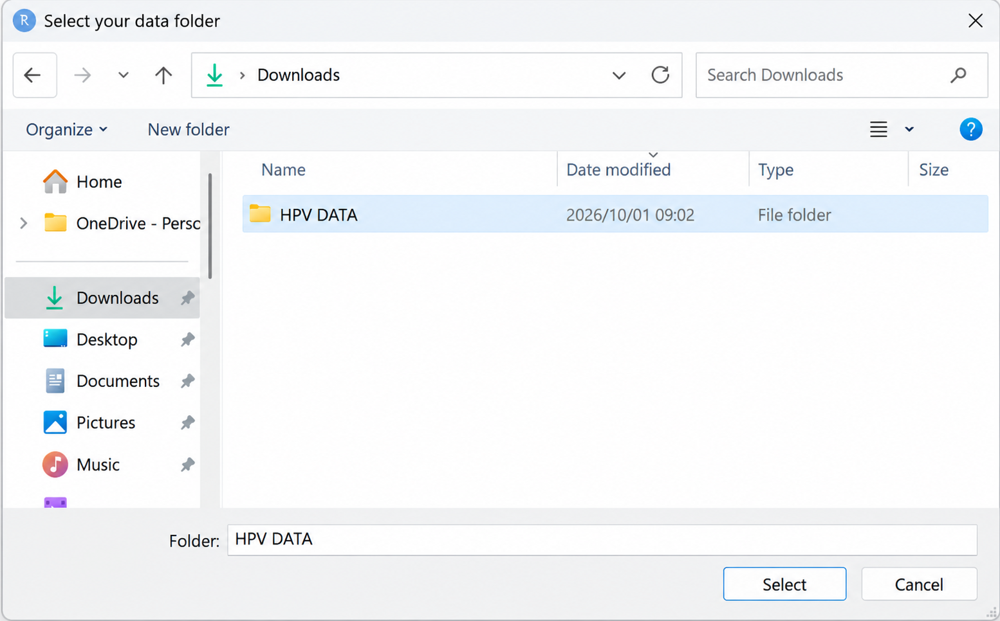
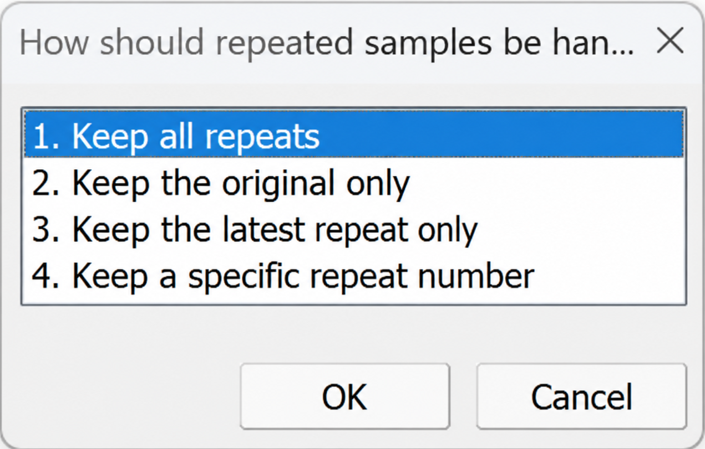
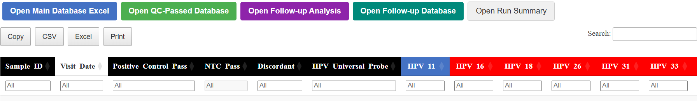

# HybriFlow

**A traceable quality-control and follow-up pipeline for HybriSpot HPV genotyping data, in R.**

HybriFlow takes the folder of per-sample **Excel probe files** and **PDF reports** produced by the HybriSpot platform and turns it into a quality-controlled, searchable sample database and, for longitudinal studies, a follow-up analysis of each woman's HPV genotypes. Every sample stays linked to its source files, reagent lot numbers and QC flags.

> HybriFlow is an independent open-source tool. It is not developed, endorsed or supported by the manufacturer of the HybriSpot platform.

**Documentation:** [Documentation site](https://tinalubamba.github.io/HybriFlow/) (installation, usage, parameters, output) · [Database user guide](https://tinalubamba.github.io/HybriFlow/user-guide.html)

## What you get

| File | What it contains |
|---|---|
| `final_database.xlsx` and `final_database.html` | One row per sample: control and NTC checks, genotype calls (high-risk red, low-risk blue), discordant positions, repeat notes, reagent lot numbers and expiry dates, Excel-versus-PDF consistency check, overall QC status and clickable links to the source files |
| `final_database_QC_passed.xlsx` | QC-passed samples, with the repeat handling you chose |
| `run_summary.txt` | Counts, top genotypes, date range, and a check of whether repeated discordant genotypes changed |
| `followup_database.xlsx` and `followup_analysis.html` | For longitudinal studies: one row per woman, with nine figures and tables (see below) |

## Install

```r
install.packages("remotes")
remotes::install_github("TinaLubamba/HybriFlow")
```

Or from a downloaded copy of the source:

```r
install.packages("path/to/HybriFlow_0.3.0.tar.gz", repos = NULL, type = "source")
```

> **If installation is blocked** by a Windows application-control message, install with base R from the unzipped folder instead: `install.packages(".", repos = NULL, type = "source")`.

## Use

```r
library(HybriFlow)
run_hybriflow()
```

That is all. Two pop-up windows ask for what the pipeline needs:

**1. Choose the data folder.** Pick the parent folder that holds all the run sub-folders (Excel files and PDF reports).

<p align="center">
  
</p>

**2. Choose how repeated samples are handled** in the QC-passed database: keep all repeats, the original only, the latest repeat only, or a specific repeat number.

<p align="center">
  
</p>

The pipeline then reads every file, runs the quality checks and writes the results to a `HybriFlow_Output` folder in your current working folder (and a zipped copy next to it). The HTML report opens in your browser when it finishes.

<p align="center">
  
</p>

To skip the pop-ups, or to change anything, pass arguments:

```r
run_hybriflow(
  data_folder     = "D:/hybriflow_runs",      # parent folder with all run sub-folders
  output_folder   = "D:/hybriflow_results",
  repeat_handling = "latest",                 # "all", "original", "latest", "specific"
  followup        = followup_settings(visits_required = 3)
)
```

| Argument | Meaning | Default |
|---|---|---|
| `data_folder` | Folder containing the run sub-folders | pop-up |
| `output_folder` | Where the results are written | `HybriFlow_Output` in the working folder |
| `repeat_handling` | `"all"`, `"original"`, `"latest"` or `"specific"` | pop-up |
| `followup` | Follow-up settings, from `followup_settings()` | 3 visits |
| `use_cache` | Re-read only new or changed files on later runs | `TRUE` |
| `force_rebuild` | Ignore the cache and re-read every file | `FALSE` |
| `selected_years` | Use only these visit years | all years |

The cache is on by default, so after the first run (which reads every file) later runs only read new or changed files.

## Follow-up analysis

For studies in which every woman is followed over several visits, HybriFlow judges each baseline genotype separately: it **persisted** if it is detected at baseline and at every follow-up visit, **cleared** if it is not detected at one or more follow-up visits (even if it is detected again later), and a genotype that was absent at baseline but detected at any follow-up visit was **acquired**. Combining these three flags gives six mutually exclusive categories: persist only, clear only, persist + clear, persist + acquire, clear + acquire, and persist + clear + acquire.
The number of study visits (baseline plus follow-ups) is a setting, so cohorts with a different design need no code changes:

```r
run_hybriflow(followup = followup_settings(visits_required = 7))   # baseline + 6 follow-ups
run_hybriflow(followup = followup_settings(run = FALSE))           # skip the follow-up analysis
```

## Sample ID format

`<13-digit sample number>_<visit code / date>`, for example `100-00-0001-0001_1-004-0_20240729`. The visit year and date are read from the part after the first underscore, and repeats carry a suffix such as `-1` or a letter after the date (`070422b`). In the follow-up analysis, when a visit has an original sample and repeats, the **latest repeat is used**, because a repeat is run when the first result is not trusted. Samples whose visit date cannot be read cannot be placed in visit order in the follow-up analysis, so please label sample IDs in this standard format.

## Notes

- Sample files are recognised by a `Target` column and need the columns `Sample ID, Target, Position, TH, LTH, Value, Result`.
- PDF reports are matched by the ID after `report_` or `report-` in the file name, or by the `ID SAMPLE` printed inside the PDF.
- A genotype is POSITIVE only if all its probe positions are positive. Disagreeing positions are flagged as discordant (a review flag, not a QC failure).

## Licence

MIT. See `LICENSE`.

## Try HybriFlow with mock data

Real HybriSpot outputs contain participant information and cannot be shared, so HybriFlow
includes **synthetic test data** and the script that generates them. Every sample ID, probe
value, lot number and date in these files is invented.

### What is included

`inst/extdata/mock_data/` holds two run folders (`run_01`, `run_02`) with 16 Excel files and
13 PDF reports for 7 invented participants, in the same layout as the HybriSpot output
(one sheet; columns `Sample ID`, `Target`, `Position`, `TH`, `LTH`, `Value`, `Result`;
81 probe spots in a 9 x 9 grid; genotype probes printed in duplicate). Each file was built to
show one situation:

| Participants | Situation shown |
|---|---|
| 0001 | HPV16 detected at visits 1 and 2, then cleared at visit 3 |
| 0002 | Two high-risk genotypes (16 and 52) that persist across three visits |
| 0003 | Genotype 31 persists, 6 clears, 51 is newly detected |
| 0004 | HPV18 with a **discordant** duplicate probe at visit 2 (the software reports negative), a **repeat** sample (`-1`) that is positive, and a third visit |
| 0005 | Amplification controls negative: insufficient material (BLANK) |
| 0006 | Hybridisation controls negative: quality-control failure |
| 0007 | HPV negative, quality-control pass, with a PDF report |

Each PDF report is named `report_<Sample ID>.pdf` and sits next to its Excel file, so the
pipeline can link the two by Sample ID. Three samples (`0002` visit 3, `0003` visit 3 and
`0006`) have **no PDF on purpose**, to exercise the handling of missing reports.
`inst/extdata/mock_expected_results.csv` lists what each file was built to show, so the
pipeline output can be compared with it.

### Run the pipeline on the mock data

```r
library(HybriFlow)
mock <- system.file("extdata", "mock_data", package = "HybriFlow")
res  <- run_hybriflow(
  data_folder     = mock,
  output_folder   = file.path(tempdir(), "mock_output"),
  repeat_handling = "latest"
)
```

The output folder then contains the sample database, the interactive report and the zip
archive. Compare the quality-control results and discordant flags with
`mock_expected_results.csv`. The values are random, so **the results illustrate how the
pipeline works and have no biological meaning.**

### Regenerate the files

From the package root (needs Python with `openpyxl` and `reportlab`):

```bash
python data-raw/make_mock_data.py
```

This rewrites the Excel files, the PDF reports and `mock_expected_results.csv`. The script uses
a fixed random seed, so it produces the same files every time. Edit the `SAMPLES` list at the
top of the script to add participants or situations.

### Limits

- Only the wording of the HPV NEGATIVE report was copied from a real report. The HPV POSITIVE
  and BLANK reports use **assumed** wording (see `report_text()` in the script). The Sample ID
  linking does not depend on this, but the comparison of the PDF status with the status derived
  from the Excel file does. If your reports read differently, edit `report_text()` and rerun.
- No-template controls are not simulated.
